<h1><u>Minishell</u></h1>

<h2>Requirements:</h2>
<ol>
    <li>Handle environment variables ($ followed by a sequence of characters) which should expand to their values. <b>[100% Done]</b>
         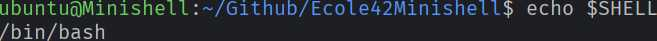
         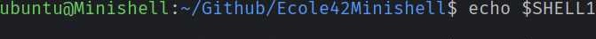
         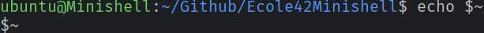
    </li>
    <li>Handle $? which should expand to the exit status of the most recently executed foreground pipeline. <b>[100% Done]</b>
    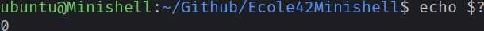
</li>
    <li>Handle ctrl-C <b>[100% Done]</b>, ctrl-D <b>[100% Done]</b> and ctrl-\ <b>[100% Done]</b> which should behave like in bash.</li>
    <li>In interactive mode:
        <ul>
            <li>ctrl-C displays a new prompt on a new line. <b>[100% Done]</b> 
                
            </li>
            <li>ctrl-D exits the shell. <b>[100% Done]</b> 
                
            </li>
            <li>ctrl-\ does nothing. <b>[100% Done]</b></li>
        </ul>
    </li>
    <li>Must implement the following built-in commands:
        <ul>
            <li>echo with option -n <b>[100% Done]</b> 
                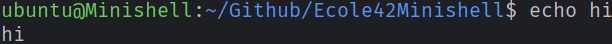 
                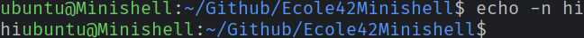
            </li>
            <li>cd with only a relative or absolute path 
                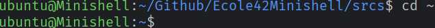 
                 
                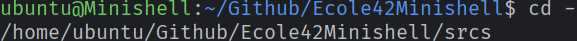 
                 
                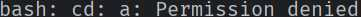
            </li>
            <li>pwd with no options <b>[100% Done]</b> 
                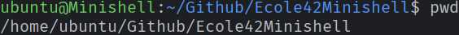 
                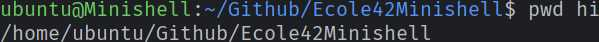
            </li>
            <li>export with no options <b>[100% Done]</b> 
                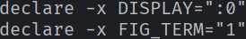 
                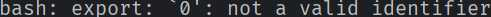 
                 
                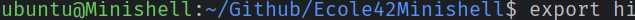 
                 
            </li>
            <li>unset with no options <b>[100% Done]</b> 
                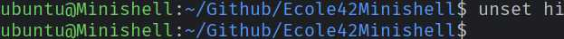 
                
            </li>
            <li>env with no options or arguments <b>[100% Done]</b> 
                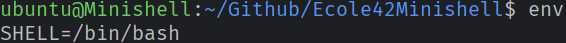 
                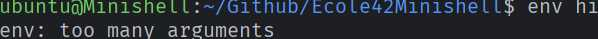
            </li>
            <li>exit with no options <b>[100% Done]</b> 
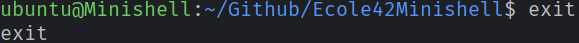
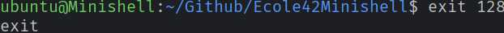
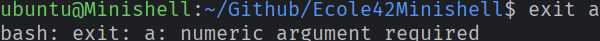
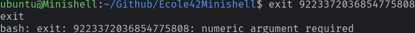
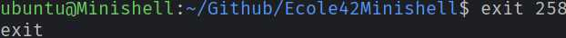=256" />
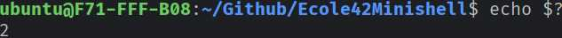=256 result" />
</li>
        </ul>
    </li>
</ol>